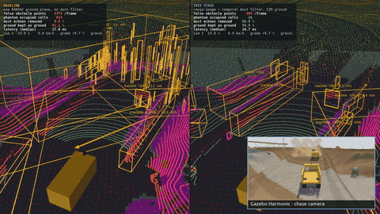
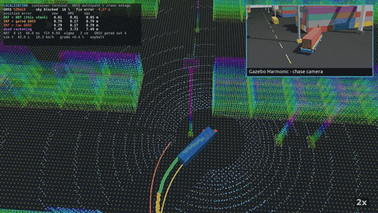
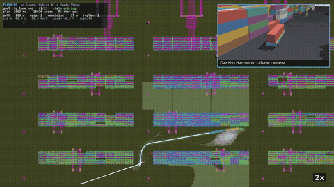
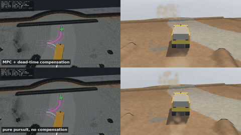
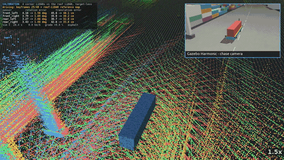
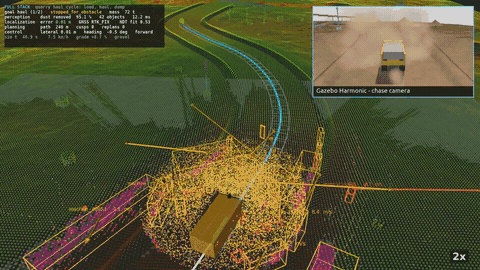

# Industrial & off-road autonomous driving stack — ROS 2 + Gazebo Harmonic

A ROS 2 Humble / C++17 autonomy stack for **ports and quarries**. It covers perception, localization,
calibration, planning and control, running closed loop in **Gazebo Harmonic**. The sensors are GPU-rendered
LiDARs, an IMU and GNSS; the trucks are physics-simulated wheeled vehicles with a drive-by-wire plugin. The
problems it targets are the ones that separate industrial sites from public roads: **dust, rough terrain,
GNSS multipath, no lanes, and heavy vehicles with slow, delayed actuators**.

Every subsystem is an **independent ROS 2 package**:
- no shared code, no custom messages;
- only standard ROS 2 / Autoware interfaces;
- its own parameters, launch file, RViz view and tests;
- each one **runs alone from a rosbag2 recording**, without the simulator.

Every number below is measured against Gazebo ground truth by a separate evaluation package.

**▶ [Showcase reel](media/showcase_reel.mp4)**  ·  six demos below  ·  `colcon test`: 35/35  ·  `scripts/isolation_check.sh`: 5/5 packages
build and pass their tests alone (31 tests)  ·  `scripts/replay_check.sh`: 5/5 run from their bags alone

## Demos

Each video is the running system: the Gazebo chase camera (GPU, top right) over the subsystem's RViz view,
both on the simulation-time axis.

| # | Demo | Preview | Headline (vs. Gazebo ground truth) |
|---|---|---|---|
| 01 | [Perception: 3D LiDAR in quarry dust](media/01_perception.mp4) |  | 15× fewer false obstacle points and 38× fewer phantom grid cells than a RANSAC baseline; 96 % ground recall; 81 % of dust removed; ~5 ms/frame |
| 02 | [Localization: GNSS-degraded container terminal](media/02_localization.mp4) |  | EKF + NDT **1.1 cm RMS** where GNSS-based filters reach 2.4–3.2 m (dead reckoning 50 m); initialises itself in 130 ms |
| 03 | [Planning: free space, no lanes](media/03_planning.mp4) |  | 228 m Hybrid A* + Reeds-Shepp in 0.8–1.3 s; stop and replan (160 m, 0.1–2 s) around an unmapped container |
| 04 | [Control: 72 t truck, 0.4 s dead time](media/04_control.mp4) |  | MPC 7.6 cm lateral RMS, reverse-docks within 3 cm; without dead-time compensation it oscillates (2.8 m) |
| 05 | [Calibration: four corner LiDARs, no targets](media/05_calibration.mp4) |  | 3.3–4.2° / 35–46 cm off → **0.014–0.021° / 0.5–1.1 cm** |
| 06 | [Full stack: quarry haul cycle](media/06_full_mission.mp4) |  | Gazebo sensors → localization → perception → planning → MPC → physics, no ground-truth shortcuts; docks within 2 cm / 1.3° |

## Architecture: five independent packages, one integration layer

```
   Gazebo Harmonic (iad_gz_sim): quarry / port SDF worlds, gpu_lidar, imu, navsat, wheeled-truck physics,
   drive-by-wire plugin, scripted traffic, particle dust  ──ros_gz_bridge──┐
                                                                          ▼  standard ROS 2 / Autoware messages
 /sensing/lidar/*/points   /sensing/imu/data   /sensing/gnss/fix   /vehicle/status/{velocity,steering}   /tf_static
        ├──► iad_perception ───► /perception/occupancy_grid (OccupancyGrid), /perception/objects (DetectedObjects)
        ├──► iad_localization ─► /localization/kinematic_state (Odometry) + TF map→base_link
        ├──► iad_calibration ──► extrinsics (YAML, TF calib/*)
        │    iad_planning ─────► /planning/trajectory (autoware_planning_msgs/Trajectory, v < 0 = reverse)
        │    iad_control ──────► /control/command (ackermann_msgs/AckermannDriveStamped) ──► Gazebo
        └─ iad_eval (ground truth; never a dependency) · iad_tools (HUD, mission, map publisher) · iad_bringup (demos)
```

| Package | Interfaces it depends on (besides rclcpp, tf2, Eigen) | Runs alone with |
|---|---|---|
| `iad_perception` | sensor_msgs, nav_msgs, visualization_msgs, autoware_perception_msgs | `perception.launch.py bag:=…` |
| `iad_localization` | sensor_msgs, nav_msgs, geometry_msgs | `localization.launch.py map_dir:=… bag:=…` |
| `iad_calibration` | sensor_msgs, nav_msgs | `calibration.launch.py bag:=…` |
| `iad_planning` | nav_msgs, geometry_msgs, autoware_planning_msgs | `planning.launch.py map_dir:=… bag:=…` |
| `iad_control` | nav_msgs, ackermann_msgs, autoware_planning_msgs, autoware_vehicle_msgs | `control.launch.py sil:=true` or `bag:=…` |

Small helpers (angle wrapping, voxel hashing, PCD / PGM readers) are copied into each package rather than
shared. Independence is checked mechanically:

- [`scripts/isolation_check.sh`](scripts/isolation_check.sh) copies each package **alone** into an empty
  workspace, then builds it and runs its tests. It fails on any `iad_*` dependency or include.
- [`scripts/replay_check.sh`](scripts/replay_check.sh) runs each package through **its own launch file on
  its own rosbag2** and checks the outputs. No Gazebo, no other subsystem.
- Every package has gtests for its algorithm core and a `launch_testing` test that drives the node with
  synthetic standard messages. Control runs closed loop on its own software-in-the-loop plant.

Each package README documents its topics: [perception](src/iad_perception/README.md),
[localization](src/iad_localization/README.md), [calibration](src/iad_calibration/README.md),
[planning](src/iad_planning/README.md), [control](src/iad_control/README.md).

## 1. Perception (`iad_perception`)

The haul truck drives the quarry haul road (9 % ramp, berms, an oncoming truck, wind-blown dust) with a
Gazebo `gpu_lidar` (32 × 1200, 10 Hz). Gazebo particle emitters scatter its rays. The same node runs twice:
as the baseline (one RANSAC ground plane, no dust filter) and as this stack.

- **Dust filter on the range image.** Gazebo has no dual returns, so three cues do the work:
  - a dust echo's range disagrees with its scan-line and adjacent-ring neighbours (closer occluders do not
    count against a point);
  - dust echoes are usually weak;
  - dust does not persist, while surfaces do: only geometry-confirmed surfaces feed the persistence memory.

  Clusters made mostly of weak echoes are dropped as residual dust.
- **Ground segmentation.** A concentric-zone model (Patchwork-style) in a gravity-aligned frame, seeded with
  the wheel plane. A bin's plane must meet its neighbour at their shared border. Bins seen only as a thin
  arc (the first ring that reaches the ground) keep the inner plane's tilt.
- **Objects and occupancy.** Clustering, oriented boxes and α-β tracking, published as
  `autoware_perception_msgs/DetectedObjects`. A log-odds grid with free-space ray tracing, written only by
  cluster-validated points; misses weigh almost as much as hits, so intermittent dust returns never become
  "occupied".

Ground truth comes from `iad_eval/perception_eval`. It labels every output point from the world geometry
(terrain, structures, live traffic poses) and calls the rest airborne dust.

| 902 frames, 90 s haul | baseline | this stack |
|---|---|---|
| false obstacle points per frame | 4 685 | **313** |
| phantom occupied grid cells | 964 | **25** |
| drivable ground kept as ground | 65 % | **96.4 %** |
| dust echoes removed (dusty frames) | 0 % | **81 %** (precision 84 %) |
| latency per frame | – | ~5 ms |

## 2. Localization (`iad_localization`)

The container AGV drives a loop between container stacks and under quay cranes. A sky-visibility model
ray-tests the GNSS antenna against the 3D terminal and degrades the Gazebo fix from RTK to float to single
to none, with multipath bias.

- **EKF** over x, y, yaw, gyro bias and odometry scale. Prediction uses wheel speed and gyro; GNSS goes
  through a χ² gate with a tilt-aware lever arm; delayed measurements are replayed.
- **NDT** on a two-level pyramid, point-to-plane on planar voxels, with a degeneracy-aware covariance.
  It matches against a PCD map that the world compiler writes from the same geometry Gazebo renders.
- **Global initialisation from scratch.** The GNSS fix gives the position; a correlative search (1° × 0.5 m)
  of the scan's structure against a likelihood field of the map's structure gives the heading; NDT polishes
  the result. Total about 130 ms.

| 175 s loop, errors vs Gazebo truth | RMS | max |
|---|---|---|
| **EKF + NDT (this stack)** | **1.1 cm** | **4.7 cm** |
| EKF + gated GNSS | 2.37 m | 6.9 m |
| EKF + raw GNSS | 3.16 m | 16.9 m |
| dead reckoning | 50 m | 82 m |

The 1 cm comes from a noise-free map that matches the simulated world exactly; on a real site, expect
5–10 cm. The comparison between the filters is the point.

## 3. Planning (`iad_planning`)

- **Search.** Hybrid A* with Reeds-Shepp analytic expansion (gear-restricted words) and RS shortcutting.
- **Costmap.** The site costmap (nav2 PGM/YAML) fused with live occupancy from perception in the near field.
- **Speed.** A velocity profile limited by curvature, terrain and steering rate.
- **Blocked path.** A stop line first; if the obstacle stays, a replan. On a surveyed route (haul road) the
  planner waits longer, because traffic usually clears.
- **Fallback.** A search boxed in by the safety margin retries with half the margin.

| Query (port, container AGV, 13 m long) | result | time |
|---|---|---|
| start → RTG lane end | 228 m, 0 cusps | 0.8–1.3 s |
| blocked by an unmapped container → replan | 160 m, 1 cusp | 0.1–2.1 s (depends on the live occupancy) |
| RTG lane → under quay crane 2 | 217–220 m, 0 cusps | 0.12–0.21 s |
| quarry: dump approach → dump bay (reverse) | 90 m, 1 cusp | 0.04 s |

## 4. Control (`iad_control`)

The 72 t loaded haul truck runs on Gazebo physics: 0.4 s actuator dead time, 0.6 s drivetrain lag,
rate-limited hydraulic steering, and a grade. It goes forward, through a cusp, then reverses into the dump
bay.

- **Lateral.** An LTV MPC (ADMM QP). Before solving, it replays the commands still in the actuator pipe.
- **Longitudinal.** PI with feed-forward for planned acceleration, rolling resistance and grade, plus a
  docking law that brakes in time to land on the end despite 1 s of latency.

| Errors of the true pose vs the trajectory | lateral RMS / max | docking (long / lat / heading) |
|---|---|---|
| **MPC + dead-time compensation** | **7.6 / 25 cm** | **+0.03 m / −0.03 m / 2.5°** |
| pure pursuit + compensation | 18.7 / 40 cm | 0.00 m / +0.11 m / 1.4° |
| pure pursuit | 25.7 / 58 cm | −0.14 m / +0.02 m / 1.9° |
| MPC without compensation | 283 / 908 cm | −0.21 m / +0.15 m / 10° |

## 5. Calibration (`iad_calibration`)

The AGV's four corner LiDARs start from nominal extrinsics that are 3–4° and 35–46 cm off. Calibration has
three steps:
1. **Parked.** A ground-plane fit per LiDAR gives roll, pitch and height.
2. **Driving past the stacks.** Joint point-to-plane registration of each LiDAR's keyframes against a
   voxel-plane map built from the roof LiDAR gives yaw, x and y.
3. **Refinement.** A final damped 6-DOF refinement.

| | rotation error | translation error |
|---|---|---|
| front_left | 4.16° → **0.021°** | 45.6 → **1.1 cm** |
| front_right | 3.79° → **0.019°** | 35.0 → **1.0 cm** |
| rear_left | 3.27° → **0.015°** | 36.7 → **1.0 cm** |
| rear_right | 3.43° → **0.014°** | 42.6 → **0.5 cm** |

## 6. Full stack

The quarry haul cycle runs with every subsystem in the loop and no ground-truth shortcuts. The loaded haul
truck:
1. follows the haul road in route mode;
2. stops for oncoming traffic and dust, and replans around an unmapped boulder;
3. Hybrid A*-plans and reverses into the dump bay.

In the recorded run: lateral tracking 5.2 cm RMS, docking at 2 cm / 0.4 cm / 1.3°, and 222 false obstacle
points/frame with 84 % of dust removed in the loop. Localization was 1.2 cm RMS in the headless runs.

## The simulation (`iad_gz_sim`, Gazebo Harmonic)

- **Compiled worlds.** `world_compiler` turns the seeded quarry and port scenarios into SDF:
  - textured terrain meshes split by surface material, so LiDAR intensity follows the ground;
  - a collision mesh, plus a separate low-friction mud collision;
  - merged structure meshes with primitive collisions;
  - scripted traffic and particle-emitter dust.

  The same geometry writes the site files the subsystems load: `pointcloud_map.pcd`, `costmap.pgm/yaml`
  and `site.yaml`.
- **Physics trucks.** The haul truck and the container AGV are articulated models: sprung chassis, steered
  front wheels and driven rear wheels, in DART. The drive-by-wire gz-sim plugin (with an embedded rclcpp
  node) models dead time, steering lag and rate limit, power and traction limits, brakes, a parking brake
  and rolling resistance by surface. Slip comes from physics.
- **Sensors.**
  - `gpu_lidar`, rendered on the GPU through EGL in Docker.
  - `imu` with bias.
  - `navsat` plus `gnss_effects`, which ray-tests sky visibility.
  - Four corner LiDARs for calibration.
- **Evaluation.** Ground truth (odometry, traffic poses, true extrinsics) goes only to `iad_eval` and to a
  stand-in route driver.

## Run it

```bash
docker build -t iad_stack:humble -f docker/Dockerfile docker     # ROS 2 Humble + Gazebo Harmonic + ros_gz
scripts/build.sh                                                  # colcon build (Release, tests on)
scripts/dev.sh colcon test && scripts/dev.sh colcon test-result --verbose

# demos (add rviz:=false headless; cameras:=true for the Gazebo chase camera)
scripts/dev.sh ros2 launch iad_bringup perception_demo.launch.py
scripts/dev.sh ros2 launch iad_bringup localization_demo.launch.py
scripts/dev.sh ros2 launch iad_bringup planning_demo.launch.py
scripts/dev.sh ros2 launch iad_bringup control_demo.launch.py algorithm:=mpc
scripts/dev.sh ros2 launch iad_bringup calibration_demo.launch.py
scripts/dev.sh ros2 launch iad_bringup mission_demo.launch.py

# one subsystem alone, from its bag (no Gazebo). The bags are not in git (3 GB); record them first with the
# matching demo, e.g. `... localization_demo.launch.py bag:=/ws/data/bags/localization_port` (demo bag names: see replay_check.sh)
scripts/dev.sh ros2 launch iad_localization localization.launch.py map_dir:=/ws/data/maps/port bag:=/ws/data/bags/localization_port
scripts/dev.sh ros2 launch iad_control control.launch.py sil:=true          # or with its own SIL plant

scripts/isolation_check.sh    # every subsystem package built + tested alone in an empty workspace
scripts/replay_check.sh       # every subsystem run alone from its bag
scripts/make_videos.sh        # record all demos (RViz capture + Gazebo GPU camera); compose with tools/video.py v3-demo
```

## Engineering notes: what Gazebo taught me

- **Headless GPU rendering in Docker.** The NVIDIA container runtime mounts `libEGL_nvidia` but not its
  GLVND vendor file. Without `10_nvidia.json`, EGL silently falls back to Mesa and Ogre2 fails. The image
  ships the file.
- **"The server hangs."** It didn't. gz-transport inside a container needs both `GZ_IP` and an explicit
  `GZ_PARTITION`; without them, `gz topic`, `gz service` and the bridge simply see nothing.
- **GNSS 500 m off.** Gazebo applies NavSat horizontal noise in *degrees*. The fix is now ideal, and all
  receiver error comes from the sky-visibility model.
- **NDT ignored at a 5 m error.** An intensity floor meant for dust also removed every asphalt return.
  In the container aisles NDT kept only two parallel walls, slid along them, and the EKF rightly gated it
  out. Keeping the ground took the loop from 5.3 m to 1.1 cm RMS.
- **Sign conventions across package boundaries.**
  - The controller sent body-x acceleration, while the drive plugin expected acceleration along the gear.
    In reverse, "speed up" meant "go forward".
  - The planner's geometric curvature and Autoware's road-wheel angle differ in sign when reversing.

  Standard messages make these contracts explicit, and each one now has a test.
- **Launch configurations are global** in ROS 2 launch. A demo's `bag:=` (record) silently turned a
  subsystem's own launch file into replay mode. Every include is now scoped.
- **A fence of phantom obstacles.** On a stopped truck, a mis-tilted thin ground arc or a dust plume is
  re-observed in the same cells every sweep, until a lethal arc boxes the planner in. The fixes were the
  thin-arc rule, the weak-cluster rule and stricter occupancy evidence. The planner's dump of its fused
  costmap on failure found it.
- **Docking 0.6–0.9 m long.** Three causes: a quantised progress index, a stopping law that counted only
  half of the 1 s actuator latency, and a DART velocity-servo "hill hold" that produced no torque. Fixed
  with continuous arc-length progress, the full latency, a braking feed-forward and a parking-brake torque
  law.
- **Delegation.** The calibration 6-DOF stage and the video compositor were written by Codex agents from
  task specs, then built, tested and measured here.

## Limitations

- **Results are from simulation.** Sensor models are Gazebo's (no motion distortion, ideal map). The
  1 cm localization and 0.02° calibration will not survive real data unchanged. The next step is replaying
  real or public bags through the same standalone packages.
- **Dust.** Gazebo's particle dust is a crude stand-in for real dust. A truck standing still inside a dense
  plume can still be fenced in by it; real systems add radar or last-return LiDAR modes.
- **Objects.** They are classified by size, and tracking is nearest-neighbour α-β.
- **Real-time factor.** Recording (software RViz + GPU camera) runs at about 0.35×. The videos are retimed
  to simulation time.

## Repository layout

```
docker/        Dockerfile (Humble + Gazebo Harmonic + ros_gz + Autoware msgs), Fast DDS profile, NVIDIA EGL file
src/           iad_gz_sim, iad_perception, iad_localization, iad_calibration, iad_planning, iad_control,
               iad_eval, iad_tools, iad_bringup
data/          maps/ (site map files); bags/ (one rosbag2 per subsystem, MCAP + zstd) is not in git (3 GB), see "Run it"
scripts/       dev.sh, build.sh, isolation_check.sh, replay_check.sh, record.sh, make_videos.sh
tools/         make_rviz.py (all RViz views), video.py / video_v3.py (retiming, compositing, cards, reel)
media/         videos, GIFs, result cards; media/v2/ holds GIF previews of the previous custom-simulator version
legacy/        the v2 custom simulator and shared packages, kept for reference (not built)
PLAN.md        the plan and milestone checklist
```
